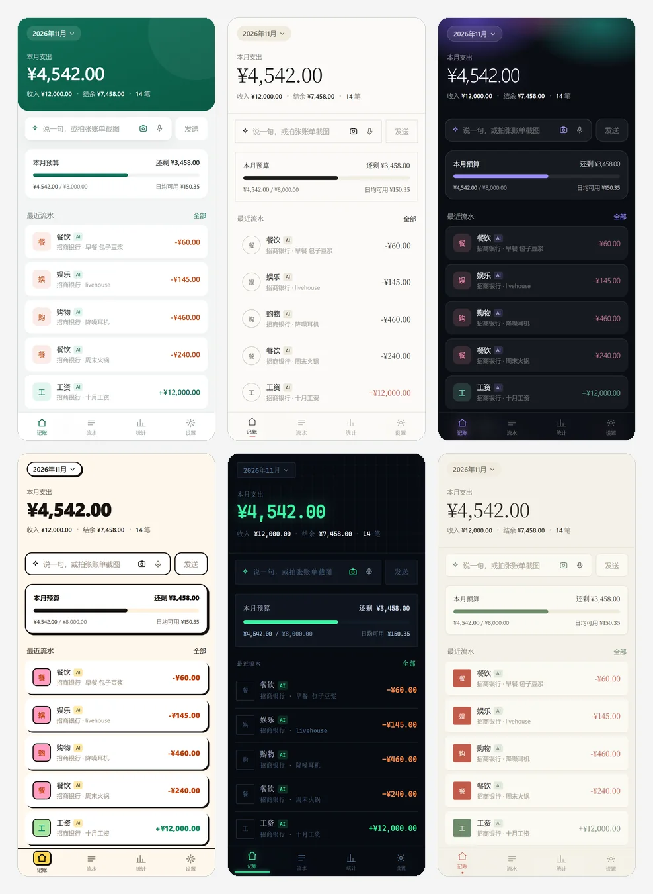
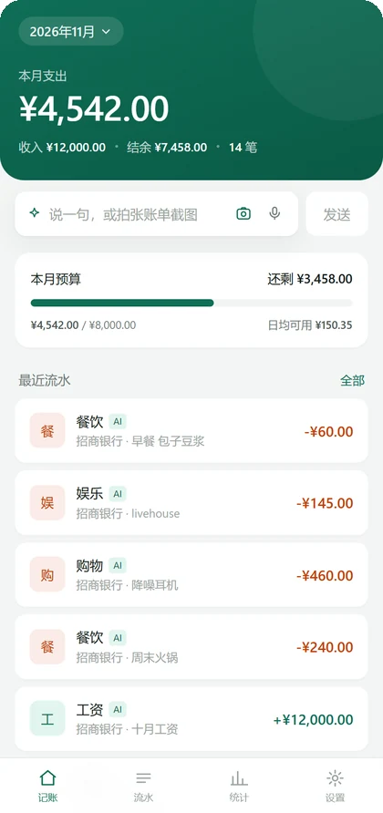
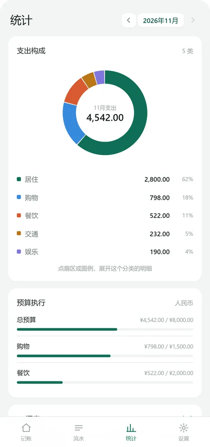
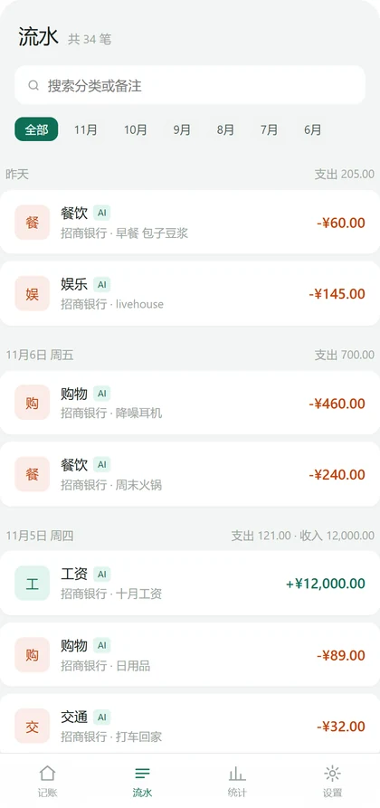

<div align="center">

<h1>小账本 · Pocket Ledger</h1>

<p><b>说一句就记好一笔的本地记账应用</b><br>
数据只存在你自己手机里，没有账号、没有服务器、没有埋点</p>

</div>



<p align="center"><sub>标准绿 · 墨韵 · 幽光 · 纸糖 · 仪表 · 青瓷</sub></p>

---

## 这是什么

一个不联网也能用的记账 App。记一笔有三种方式：

- ⌨️ **打一句** —— 「午餐牛肉面 58」，AI 拆成金额、分类、备注
- 🎙 **说一句** —— 语音识别完自动提交，不用再点一下
- 📷 **拍一张** —— 账单截图丢进去，一张图里的多笔一次识别，逐条确认后入库

记完的东西全部存在本机 IndexedDB。不注册、不上传、不同步（云备份要你自己主动开）。

同一份代码出两种形态：

| | 安卓 | iPhone |
|---|---|---|
| 形态 | 原生 APK（Capacitor） | PWA，Safari 添加到主屏幕 |
| 桌面图标跟随皮肤 | ✅ 六套图标 | ❌ 固定一个 |
| 状态栏配色跟随皮肤 | ✅ | ❌ 跟系统 |

## 功能

### 记账

- 文本 / 语音 / 图片三种输入，AI 解析成结构化账目
- 批量识图：一张截图里多笔消费，逐条勾选后入库
- 分类、账户、备注、日期都可改，支持补记
- 收入与支出，本月结余实时算

### 统计

- 支出构成环图，点扇区或图例展开分类明细
- 近十二个月柱状图，按住左右滑，点柱子看当月明细
- 分类排行与笔数对比

### 预算

- 整月总额 + 分类预算（分类留空 = 不限制）
- 首页卡片显示进度、剩余、日均可用
- 超支自动变红并列出具体超了哪几类
- **按月固定、按币种隔离**：切主币种可以另设一套，不会串数

### 多币种

- 主币种可切换，汇率手动维护
- 每笔账带自己的币种，统计时按主币种折算

### 皮肤

- 六套完整皮肤，不是换个背景色：字体、圆角、阴影、描边、底栏图标线条、图表调色板全部跟着换
- 安卓 APK 里桌面图标也一起换（`activity-alias` 机制）
- 深色皮肤下系统控件（下拉框、日期选择器）一并变暗

### 双语

- 中文 / English，安装后**默认跟随系统语言**：手机是中文就中文，其它语言一律英文
- 设置 → 语言里可手动切换（跟随系统 / 中文 / English），切完立刻生效，不用重启
- 日期、月份、金额格式跟着语言走（`2026年10月` ↔ `Oct 2026`）
- 用户自己起的分类名、备注不翻译，只翻内置词汇

### 备份

- 导出 / 导入 JSON，含皮肤与预算设置
- 直接传到百度网盘或 OneDrive（需自备开放平台凭据）

## 界面

| 首页 | 统计 | 流水 |
|---|---|---|
|  |  |  |

## 下载

| 渠道 | 地址 | 适合 |
|---|---|---|
| 落地页（推荐） | https://pocket-ledger-apk.app.workbuddy.host/?sharecode=QASKTFVBJT | 国内访问快。安卓下 APK、iPhone 直接用网页版，中英介绍页一并提供 |
| GitHub Releases | [Latest release](https://github.com/mo0981/pocket-ledger/releases/latest) | 海外用户、只要 APK 直链，或落地页打不开时备用 |

两个渠道放的是**同一个包**：`xiaozhangben-v2.18.apk`，4,960,498 字节，MD5 `8bcbdbf9fc183edb9e5d60402e9cf507`。

iPhone 不用装包：打开落地页 →「不装包，直接用网页版」→ Safari 分享 → 添加到主屏幕。

> 安装包是 debug 签名的自用版本，没有上架应用商店。

## 快速开始

### 网页版

```bash
npm install
node serve.js          # http://localhost:5180
```

必须走 `http://`，直接双击 `index.html` 用 `file://` 打不开 —— Service Worker 和 IndexedDB 在本地文件协议下都受限。

### 打包安卓

前置：JDK 21、Android SDK（`ANDROID_HOME` 指向 SDK 目录）

```bash
npm install
node build.js                    # 生成 www/
npx cap sync android             # 同步进安卓工程
cd android && ./gradlew assembleDebug
cd .. && node release.js         # 归档并打印版本与 MD5
```

产物在 `android/app/build/outputs/apk/debug/app-debug.apk`。

`npm run apk` 一键跑完这套流程（脚本里用的是 Windows 的 `gradlew.bat`，macOS / Linux 把那条命令换成 `./gradlew` 即可）。

> `release.js` 只会写项目内的 `release/`。桌面那份镜像只在你机器上已经存在「桌面/小账本」文件夹时才会写，别人克隆下来不会在自己桌面凭空多出东西。

## 配置 AI

打开「设置 → AI」：

| 项 | 说明 |
|---|---|
| 提供商 | DeepSeek / Gemini / OpenRouter / 硅基流动 / 通义千问 / 自定义（OpenAI 兼容） |
| API Key | 填自己的。**只存本机 IndexedDB，不会发到任何第三方** |
| 识图模型 | 可以和文本模型分开。DeepSeek 的 `deepseek-flash` 原生支持图片，不用另配 |

没配 Key 也能用：手动记账、统计、预算、皮肤全都正常，只是 AI 解析和识图会提示未配置。

各家 Key 自己去控制台申请，本项目不带任何内置额度。

## 云备份（可选）

百度网盘和 OneDrive 都走 OAuth 授权码模式，需要在对应开放平台注册一个应用，把 AppKey / Client ID 填进设置页。

> ⚠️ **这是纯前端应用，SecretKey 只能存在浏览器本地。** 百度开放平台不支持 PKCE，换 token 的请求必须带上 secret，这是平台限制、不是实现选择。
> 自用没问题，但**别把自己的 SecretKey 发给别人**。

不配也行，直接用「导出备份」存 JSON 文件。

## 项目结构

```
index.html            单页结构（首页 / 流水 / 统计 / 设置）
style.css             全部样式：设计令牌 + 六套主题覆盖
manifest.json         PWA 清单
sw.js                 Service Worker，网络优先 + 断网回落缓存

js/
  app.js              视图、交互、皮肤、预算
  db.js               IndexedDB 封装（tx / cats / settings 三个 store）
  ai.js               各家模型调用、结果解析、报错翻译
  chart.js            SVG 手绘环图与柱状图
  baidu.js            百度网盘备份
  onedrive.js         OneDrive 备份
  i18n.js             中英词典、语言探测、DOM 翻译层

build.js              把源文件拷进 www/
serve.js              本地静态服务
release.js            归档 APK、算 MD5、清理旧版本
tools/gen-icons.mjs   由 SVG 生成六套图标（90 张 PNG + adaptive XML）
design-lab.html       六套皮肤的对比展厅

android/              Capacitor 工程
  .../AppIconPlugin.java   切换 activity-alias 换桌面图标
  .../UiPlugin.java        状态栏图标深浅跟随皮肤
```

## 测试

19 个测试脚本，Puppeteer 驱动真实 Chrome，覆盖记账、批量识图、统计点击、皮肤切换、图标别名、月份面板、预算计算、排版约束（元素不重叠、小字不叠字、字距必须用 `em`）。

```bash
node serve.js &        # 测试跑在 localhost:5180
node test.mjs
node test-budget.mjs   # 单跑某一个
```

脚本里把 Chrome 路径写死在 `C:/Program Files/Google/Chrome/Application/chrome.exe`，其他平台改一下 `executablePath` 即可。

## 数据与隐私

- 没有后端、没有账号、没有行为统计
- 账目存在浏览器 IndexedDB，卸载 App 或清除数据即消失
- AI 请求只发给你自己配置的那家服务商，请求内容是该次记账的文本或图片
- 云备份是显式操作，不会后台偷偷上传

**记得定期导出备份。**

## 已知限制

- 桌面图标跟随皮肤只在安卓 APK 内有效；PWA 和网页版固定一个图标
- 网页版换肤后系统状态栏颜色不变（iOS 不允许网页改）
- 语音走 Web Speech API，Safari 支持不稳定，不支持时麦克风按钮自动隐藏
- 百度 OAuth 的回调地址不接受 `localhost`，本地调试得用局域网 IP 或已备案域名
- MIUI / ColorOS 换完图标有缓存延迟，可能要等几秒才刷新
- 预算按币种隔离，切换主币种后看到的是另一套数据（按设计如此，不是 bug）

## License

[MIT](LICENSE)
